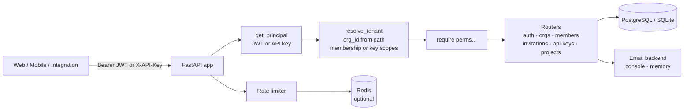

# Multi-tenant SaaS Auth

Authentication, authorization and tenancy service for multi-tenant SaaS products, built with FastAPI and SQLAlchemy 2.

[](https://github.com/AkibUllah/multi-tenant-saas-auth/actions/workflows/ci.yml)


## Why this exists

Every B2B product I have worked on, from merchant back-offices to cloud customer portals, ended up re-implementing the same auth core: users who belong to several organizations with different roles in each, refresh tokens that need revoking when a laptop is lost, API keys for integrations, and the nagging question "did we remember to filter this query by tenant?". This service packages those pieces into one well-tested codebase. Tenant scoping is enforced in a single dependency (`require(...)`), not sprinkled through handlers, and the demo `projects` resource proves the isolation end to end.

## Features

- Users, organizations (tenants) and memberships with four roles: owner, admin, member, viewer
- Flat permission vocabulary (`projects:create`, `members:invite`, ...) shared by roles and API key scopes; `require("perm")` route dependency resolves tenant + permissions in one place
- Short-lived JWT access tokens plus rotating refresh tokens stored as SHA-256 hashes; replaying a rotated token revokes the whole token family (reuse detection)
- bcrypt password hashing, login brute-force lockout, timing-equalised login for unknown accounts
- Email verification and password reset via single-use tokens (console email backend; in-memory backend for tests)
- Per-organization API keys (`sk_<prefix>_<secret>`): prefix lookup, hashed secret, scopes capped at the creator's permissions, `last_used_at`, revocation
- Invitations by email with accept tokens; last-owner protection, owner-only ownership transfer
- Fixed-window rate limiting on auth endpoints with Redis backend when `REDIS_URL` is set and an in-process fallback otherwise
- Non-member requests to an organization return 404, so organization ids cannot be enumerated
- `/health` endpoint, request ids and timing logs, environment-driven configuration

## Architecture



Key decisions:

- **One tenancy choke point.** `resolve_tenant` loads the org from the URL, finds the caller's membership (or validates the API key belongs to that org) and returns a `TenantContext`. Handlers filter every query by `ctx.org.id`; a resource id alone never grants access.
- **Refresh token families.** Each login opens a family; each refresh revokes the presented token and issues a child in the same family. A replayed token is treated as theft and the entire family is revoked, which logs out the attacker and the victim's stolen session without touching other devices.
- **Permissions as strings.** Roles map to permission sets; API key scopes use the same strings. That keeps `require("projects:create")` identical for human and machine callers, and a key can never carry more than its creator held.
- **No native-enum or timezone surprises.** Roles are stored as plain strings and a `UTCDateTime` type decorator keeps datetimes timezone-aware on SQLite and Postgres alike, so tests run on SQLite with no behavioural drift.
- **Swappable infrastructure.** Rate limiting and email sit behind small protocols; tests use the in-memory implementations, production uses Redis and a real mail provider.

## Tech Stack

| Layer | Choice |
| --- | --- |
| Web framework | FastAPI, Pydantic v2, pydantic-settings |
| Persistence | SQLAlchemy 2.0 ORM; SQLite (dev/tests), PostgreSQL via psycopg 3 (compose) |
| Auth | PyJWT (HS256 access tokens), bcrypt, SHA-256 hashed opaque tokens |
| Rate limiting | Redis (`redis-py`) or in-process store, fixed window |
| Tooling | pytest, httpx TestClient, fakeredis, ruff, GitHub Actions |
| Runtime | Docker (python:3.11-slim, non-root), docker compose with Postgres 16 + Redis 7 |

## Quick Start

### Docker compose (Postgres + Redis)

```bash
git clone git@github.com:AkibUllah/multi-tenant-saas-auth.git
cd multi-tenant-saas-auth
docker compose up --build
# API: http://localhost:8000  ·  OpenAPI docs: http://localhost:8000/docs
```

### Local (SQLite, in-memory rate limiter)

```bash
python3 -m venv .venv && source .venv/bin/activate
pip install -e ".[dev]"
cp .env.example .env            # edit JWT_SECRET
uvicorn saas_auth.asgi:app --reload
```

Try it:

```bash
# Register, then log in
curl -s -X POST localhost:8000/v1/auth/register -H 'content-type: application/json' \
  -d '{"email":"rahim@example.com","password":"correct-horse-battery","full_name":"Rahim Uddin"}'
TOKENS=$(curl -s -X POST localhost:8000/v1/auth/login -H 'content-type: application/json' \
  -d '{"email":"rahim@example.com","password":"correct-horse-battery"}')
ACCESS=$(echo "$TOKENS" | python3 -c 'import json,sys; print(json.load(sys.stdin)["access_token"])')

# Create an organization (caller becomes owner) and a tenant-scoped project
ORG=$(curl -s -X POST localhost:8000/v1/orgs -H "authorization: Bearer $ACCESS" \
  -H 'content-type: application/json' -d '{"name":"Dhaka Fintech Ltd"}' | python3 -c 'import json,sys; print(json.load(sys.stdin)["id"])')
curl -s -X POST localhost:8000/v1/orgs/$ORG/projects -H "authorization: Bearer $ACCESS" \
  -H 'content-type: application/json' -d '{"name":"bKash integration"}'
```

The verification email (and later invitation / reset emails) are printed to the server log by the console email backend.

## API

| Method | Path | Permission | Description |
| --- | --- | --- | --- |
| GET | `/health` | – | Liveness + DB check, which rate limiter backend is active |
| GET | `/v1/permissions` | – | Role → permission map |
| POST | `/v1/auth/register` | – | Create user, send verification email |
| POST | `/v1/auth/login` | – | Password login → access + refresh tokens (lockout after N failures) |
| POST | `/v1/auth/refresh` | – | Rotate refresh token (reuse detection) |
| POST | `/v1/auth/logout` | – | Revoke one refresh token |
| POST | `/v1/auth/logout-all` | user | Revoke all sessions of the current user |
| GET | `/v1/auth/me` | user | Current user profile |
| POST | `/v1/auth/verify-email` | – | Consume verification token |
| POST | `/v1/auth/resend-verification` | user | Re-send verification email |
| POST | `/v1/auth/forgot-password` | – | Send reset token (same response whether the account exists) |
| POST | `/v1/auth/reset-password` | – | Set new password, revoke all sessions |
| POST | `/v1/auth/change-password` | user | Change password with current password |
| POST | `/v1/orgs` | user | Create organization, caller becomes owner |
| GET | `/v1/orgs` | user | Organizations the caller belongs to, with role |
| GET / PATCH / DELETE | `/v1/orgs/{org_id}` | `org:read` / `org:update` / `org:delete` | Organization details |
| GET | `/v1/orgs/{org_id}/members` | `members:read` | List members |
| PATCH | `/v1/orgs/{org_id}/members/{user_id}` | `members:update` | Change role (ownership changes are owner-only) |
| DELETE | `/v1/orgs/{org_id}/members/{user_id}` | `members:remove` | Remove member (last owner protected) |
| POST | `/v1/orgs/{org_id}/members/leave` | `org:read` | Leave organization |
| POST / GET | `/v1/orgs/{org_id}/invitations` | `members:invite` / `members:read` | Invite by email, list invitations |
| DELETE | `/v1/orgs/{org_id}/invitations/{id}` | `members:invite` | Revoke invitation |
| POST | `/v1/invitations/accept` | user | Accept an invitation token (email must match) |
| POST / GET | `/v1/orgs/{org_id}/api-keys` | `api_keys:create` / `api_keys:read` | Mint key (secret shown once), list keys |
| DELETE | `/v1/orgs/{org_id}/api-keys/{key_id}` | `api_keys:revoke` | Revoke key |
| POST / GET | `/v1/orgs/{org_id}/projects` | `projects:create` / `projects:read` | Tenant-scoped demo resource |
| GET / PATCH / DELETE | `/v1/orgs/{org_id}/projects/{id}` | `projects:read` / `projects:update` / `projects:delete` | Project detail |

Authentication is either `Authorization: Bearer <access_token>` or `X-API-Key: sk_...`. API keys are bound to one organization and to the scopes granted at creation.

### Roles

| Permission | viewer | member | admin | owner |
| --- | :-: | :-: | :-: | :-: |
| `org:read`, `members:read`, `projects:read` | ✓ | ✓ | ✓ | ✓ |
| `projects:create`, `projects:update` | | ✓ | ✓ | ✓ |
| `org:update`, `members:invite`, `members:update`, `members:remove`, `projects:delete`, `api_keys:*` | | | ✓ | ✓ |
| `org:delete`, `billing:manage` | | | | ✓ |

## Project Structure

```
src/saas_auth/
├── asgi.py           # uvicorn entrypoint
├── main.py           # create_app() factory, middleware, router wiring
├── config.py         # Settings (env / .env)
├── database.py       # engine/session helpers, UTCDateTime
├── models.py         # User, Organization, Membership, RefreshToken, EmailToken, ApiKey, Invitation, Project
├── schemas.py        # Pydantic request/response models
├── security.py       # bcrypt, JWT, API key parsing, Principal resolution
├── tokens.py         # refresh token rotation + reuse detection, email tokens
├── rbac.py           # roles, permission map, resolve_tenant, require()
├── ratelimit.py      # RateLimiter + InMemory/Redis backends, route dependency
├── emailer.py        # console / memory email backends, Mailer
└── routers/          # auth, orgs, members, invitations, api_keys, projects, health
tests/                # 52 tests, SQLite in-memory, fakeredis
Dockerfile · docker-compose.yml · Makefile · .github/workflows/ci.yml
```

## Testing

```bash
make test          # or: pytest
make lint
```

Tests run against an in-memory SQLite database and an in-memory email outbox, so no services are required. Coverage includes:

- refresh token rotation, reuse detection (family revocation), expiry, logout / logout-all
- role → permission nesting, `require()` enforcement, last-owner protection, owner-only role grants
- tenant isolation: cross-org reads return 404, foreign ids are unreachable through your own org, API keys pinned to their org
- API keys: single-shot secret, scope validation and escalation checks, revocation, `last_used_at`
- rate limiting with an injectable clock on both backends (fakeredis for Redis), 429 headers, login lockout and counter reset
- invitation lifecycle: email delivery, email mismatch, duplicates, revocation, expiry
- registration, login, email verification, password reset / change

## Roadmap

- Alembic migrations (tables are currently created with `create_all` at startup)
- Optional TOTP second factor and WebAuthn passkeys
- Audit log of security events (role changes, key creation, lockouts) with an export endpoint
- OAuth2 / OIDC login (Google, GitHub) mapped onto the same user + membership model
- Sliding-window rate limiting and per-organization quotas

## License

MIT © 2026 Akib Jafor
